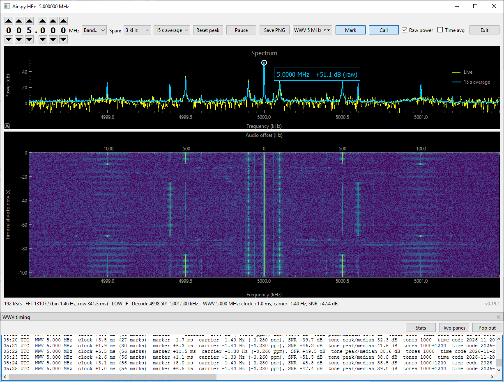
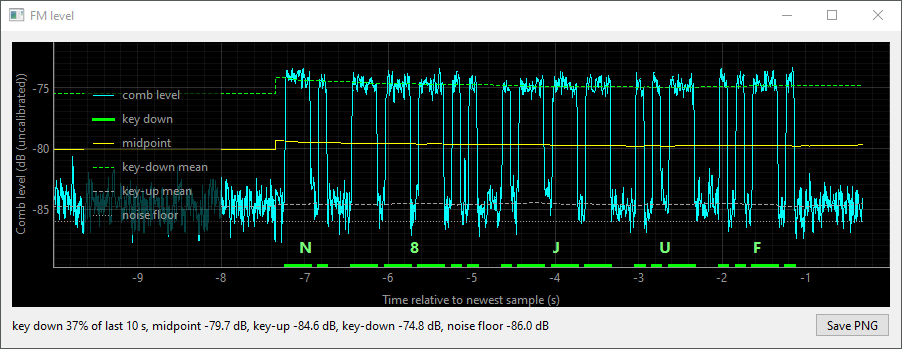

Utilities to assist evaluation of ham radio signal strength in various situations. 
I'm using the Nooelec RTL-SDR v5 (100kHz-1.75GHz) Software Defined Radio (RTL2832U).
This has quite reasonable performance on shortwave (in "direct sampling" mode) unlike some other units.
Later I got the AirSpy HF+ Discovery which has even better performance on shortwave (but doesn't include anything above VHF).

The "airspy_live.py" program displays a waterfall, can decode FT8, and also reads NIST WWV timecode and compares the local system clock offset with it.

